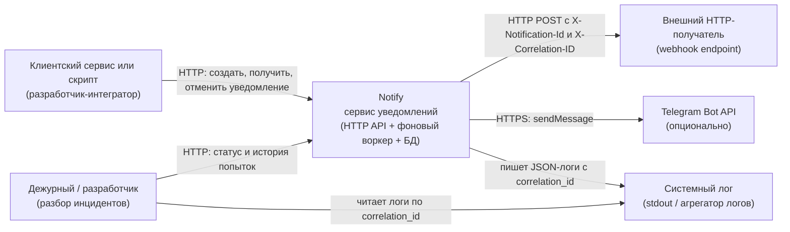
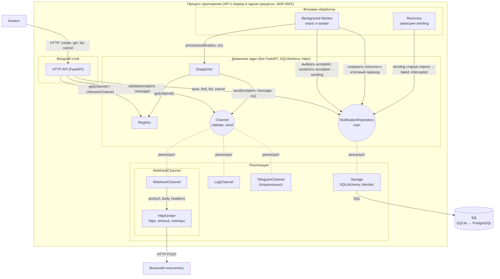

# Архитектура Notify

Документ описывает архитектуру сервиса уведомлений Notify на двух уровнях: контекст (как система взаимодействует с внешним миром) и компоненты (из чего состоит внутри).

Связанные документы:

- жизненный цикл уведомления и запрещённые переходы — [state-machine.md](state-machine.md);
- контракт канала (Tool) и два канала — [tool-contract.md](tool-contract.md);
- контракт API — [api/openapi.yaml](api/openapi.yaml);
- решения — [ADR-0001 фоновый воркер](adr/0001-background-worker.md), [ADR-0002 ключ идемпотентности](adr/0002-idempotency-key-storage.md), [ADR-0003 без аутентификации](adr/0003-no-authentication.md), [ADR-0004 порт хранилища](adr/0004-repository-port.md);
- проверка контракта колодой — [contract-check.md](contract-check.md).

## Контекстная схема (C4: Context)

**Что показывают стрелки:** направленные вызовы между системами во время выполнения. Стрелка идёт от инициатора вызова к тому, кто его обрабатывает; подпись — протокол и смысл вызова.

| Элемент | Ответственность | Что скрывает от соседей |
|---|---|---|
| Клиентский сервис | Создаёт, читает и отменяет уведомления через API | Свою внутреннюю логику: для Notify это просто HTTP-клиент |
| Дежурный | Разбирает, почему уведомление не доставлено: статус и попытки через API, подробности по `correlation_id` в логах | Внешний актор |
| Notify | Принимает заявки, доставляет сообщения через каналы, хранит статус и историю попыток | Выбор момента отправки, повторы, устройство каналов |
| Внешний HTTP-получатель | Принимает webhook-доставку, отсекает дубли по `X-Notification-Id` | Своё устройство: для Notify это URL и код ответа |
| Telegram Bot API | Доставляет сообщения в Telegram (если хватит времени на канал) | Устройство мессенджера |
| Системный лог | Хранит структурированные логи | Где и как физически агрегируются логи |

## Компонентная схема (C4: Component)

**Что показывают стрелки:**

- **сплошные с подписью** — вызовы кода во время выполнения: кто кого вызывает и с чем;
- **пунктирные** — зависимость по интерфейсу: `LogChannel`, `WebhookChannel`, `TelegramChannel` реализуют `Channel`, `Storage` реализует порт `NotificationRepository`. Ядро зависит только от интерфейсов, а реализации зависят от ядра.

**Кто за что отвечает при отправке.** Захват (`accepted → sending`) выполняет **воркер** условным `UPDATE` через репозиторий. `Dispatcher` БД не знает: он получает захваченное уведомление, вызывает канал, применяет переход `sending → delivered / failed` к доменному объекту (проверка переходов в одном месте, в `Notification`) и возвращает результат. Воркер сохраняет попытки и итоговый переход тоже условным `UPDATE` (`WHERE status = 'sending'`). Это сохраняет требование «ядро не зависит от БД» (CONTRIBUTING).

| Компонент | За что отвечает | Что скрывает от соседей |
|---|---|---|
| HTTP API | Приём запросов, проверка размера тела, JSON, `Idempotency-Key`, канала и параметров (через `Registry` и `Channel.validate`) до сохранения; единый формат ошибок; `correlation_id`; создание с обработкой нарушения уникальности ключа | Фреймворк (FastAPI), сериализацию, формат HTTP-данных |
| Background Worker | Каждые `WORKER_POLL_INTERVAL_SECONDS` читает `accepted`, захватывает условным обновлением, до `WORKER_CONCURRENCY` отправок параллельно, сохраняет результат | Расписание опроса, конкурентность, как устроен захват |
| Recovery | При старте и каждые `RECOVERY_INTERVAL_SECONDS` переводит `sending` старше `SENDING_STALE_AFTER_SECONDS` в `failed` с причиной `interrupted` | Порог и способ поиска зависших |
| Dispatcher | Находит канал в `Registry`, вызывает `send`, применяет переход по `ToolResult`; перехватывает исключение канала и ставит `internal_error` | Какие каналы существуют, устройство канала, хранилище |
| Registry | Соответствие «имя канала → реализация `Channel`», ошибка `UnknownChannel` | Как каналы создаются и настраиваются |
| Channel (интерфейс) | Контракт: `validate(recipient, message)`, `send(recipient, message, ctx) → ToolResult`; подробности в [tool-contract.md](tool-contract.md) | Любые детали конкретного канала |
| LogChannel, WebhookChannel, TelegramChannel | Доставка в свой транспорт; формат `recipient` знает только канал | Транспорт, формат запроса, правила повторов |
| HttpSender | Порт в ядре, подключается к `WebhookChannel` (и `TelegramChannel`, у каждого свой экземпляр): timeout, повторы, классификация ответа, лимит чтения. Реализация на httpx лежит вне ядра (`src/notify/adapters`, практика 6), в тестах подставляется fake | httpx и нюансы транспорта; снаружи канала не виден |
| NotificationRepository (порт) | Операции над уведомлениями и попытками, включая условные переходы и вставку с проверкой уникальности ключа; один метод — одна транзакция ([ADR-0004](adr/0004-repository-port.md)) | Что за СУБД и как устроен SQL |
| Storage | Реализация порта: таблица `notifications` (с `idempotency_key` UNIQUE и `request_hash`) и `delivery_attempts`; миграции Alembic | SQLite или PostgreSQL, ORM-маппинг |

## Как архитектура защищена от изменений

- Новый канал: реализация `Channel` и регистрация в `Registry`; `Dispatcher`, API и воркер не меняются.
- Смена БД: затрагивает только `Storage` и миграции.
- Вынос воркера в отдельный процесс (условие пересмотра ADR-0001): `Worker`, `Recovery` и `Dispatcher` переезжают как есть, потому что общаются с остальными только через репозиторий.
- LLM во втором семестре встаёт перед `HTTP API` и выбирает канал из `GET /channels`; ядро не меняется.

## Что не показано намеренно

- Аутентификации нет: см. [ADR-0003](adr/0003-no-authentication.md).
- Брокера сообщений нет: очередью служит таблица `notifications` ([ADR-0001](adr/0001-background-worker.md)).
