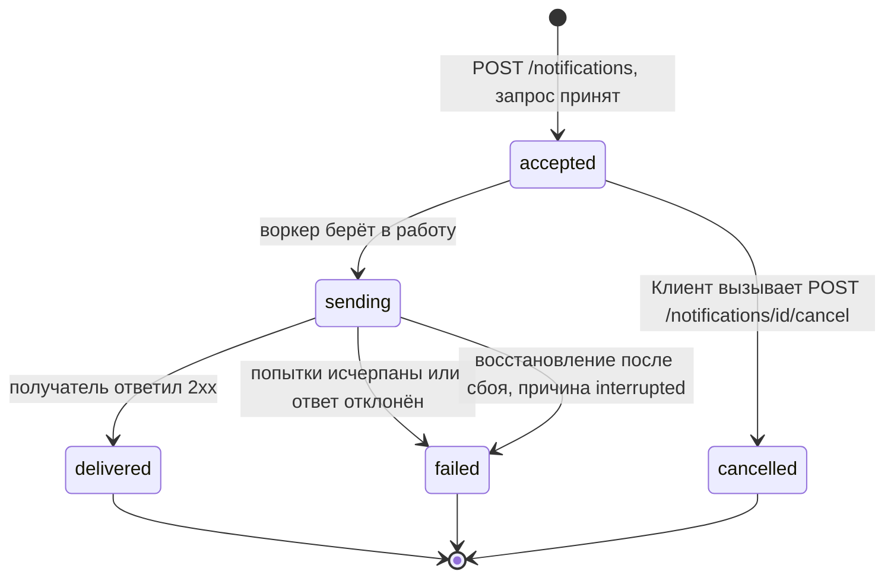

# Жизненный цикл Job (Notification)

Job в Notify — это `Notification`. Все проверки переходов выполняются в одном месте: в доменном классе `Notification` (таблица разрешённых переходов). Переходы из `accepted` дополнительно защищены условным обновлением в БД (см. «Конкурентные переходы»).

## Диаграмма состояний



**Что показывают стрелки.** Стрелка — разрешённый переход состояния. Подпись на стрелке — кто или что его инициирует. Это не вызовы между компонентами, а изменения статуса уведомления. Все переходы, которых на диаграмме нет, запрещены.

## Состояния

| Состояние | Смысл | Конечное |
|---|---|---|
| `accepted` | Принято и сохранено, ждёт отправки | нет |
| `sending` | Воркер взял в работу, идёт отправка | нет |
| `delivered` | Доставлено | да |
| `failed` | Не доставлено, причина сохранена | да |
| `cancelled` | Отменено Клиентом до отправки | да |

## Разрешённые переходы

| Откуда | Куда | Кто инициирует | Условие |
|---|---|---|---|
| `[*]` | `accepted` | Клиент (`POST /notifications`) | Запрос прошёл валидацию (S5), канал есть в Registry |
| `accepted` | `sending` | Воркер | Условное обновление: `WHERE id = ? AND status = 'accepted'`, затронута 1 строка |
| `accepted` | `cancelled` | Клиент (`POST /notifications/{id}/cancel`) | Условное обновление, как выше |
| `sending` | `delivered` | Воркер / Dispatcher | Канал вернул успех (для webhook: ответ `2xx`) |
| `sending` | `failed` | Воркер / Dispatcher | Попытки исчерпаны или получатель отклонил запрос; причина записывается |
| `sending` | `failed` | Восстановление после сбоя | Уведомление в `sending` дольше заданного времени; причина `interrupted` |

### Причины `failed`

| Причина | Когда |
|---|---|
| `timeout` | Получатель не ответил за 5 с на всех 3 попытках (1 + 2 повтора) |
| `rejected_by_receiver` | Получатель ответил `4xx`; повторов нет |
| `receiver_error` | Получатель отвечал `5xx` на всех 3 попытках |
| `bad_response` | Соединение разорвано или ответ не разбирается как HTTP, после повторов |
| `interrupted` | Уведомление «зависло» в `sending` (воркер упал или был перезапущен) |
| `invalid_params` | Канал при отправке отклонил параметры (защитная проверка, на практике не должно случаться) |
| `internal_error` | Неожиданное исключение в коде канала; `Dispatcher` перехватил его, воркер продолжает работу |

## Запрещённые переходы

Матрица всех пар состояний: `✓` — разрешён, `✗` — запрещён.

| Из \ В | `accepted` | `sending` | `delivered` | `failed` | `cancelled` |
|---|---|---|---|---|---|
| `accepted` | ✗ | ✓ | ✗ | ✗ | ✓ |
| `sending` | ✗ | ✗ | ✓ | ✓ | ✗ |
| `delivered` | ✗ | ✗ | ✗ | ✗ | ✗ |
| `failed` | ✗ | ✗ | ✗ | ✗ | ✗ |
| `cancelled` | ✗ | ✗ | ✗ | ✗ | ✗ |

Из 25 пар разрешены 4, остальные 21 запрещены. Ответ системы зависит от того, откуда пришла попытка.

### Попытки из API

Из API можно инициировать только один переход: отмену. Остальные переходы выполняет только Система.

| Попытка | Ответ системы |
|---|---|
| Отмена из `sending` | `409`, `invalid_transition`; состояние не меняется |
| Отмена из `delivered` | `409`, `invalid_transition`; состояние не меняется |
| Отмена из `failed` | `409`, `invalid_transition`; состояние не меняется |
| Отмена из `cancelled` (повторная отмена) | `409`, `invalid_transition`; состояние не меняется |
| Отмена несуществующего `id` | `404`, `not_found` (это не переход, объекта нет) |

Пример тела ответа (единый формат ошибок):

```json
{
  "error": {
    "code": "invalid_transition",
    "message": "Cannot cancel notification in state 'sending'",
    "details": {
      "notification_id": "<id>",
      "current_status": "sending",
      "requested_status": "cancelled"
    },
    "correlation_id": "<correlation_id>"
  }
}
```

### Внутренние попытки (не из API)

Остальные запрещённые переходы (например, `delivered → sending`, `failed → sending`, `cancelled → sending`, `sending → cancelled`, `accepted → delivered`) клиент вызвать не может: для них нет эндпоинта. Если код всё же пытается выполнить такой переход:

- доменный класс выбрасывает `InvalidTransition`, состояние не меняется;
- воркер перехватывает исключение, пишет в лог ошибку (`notification_id`, текущее и запрошенное состояния, `correlation_id`) и переходит к следующему уведомлению; воркер не останавливается;
- если исключение возникло при обработке запроса API, оно преобразуется в `409 invalid_transition`; ответ `5xx` не возвращается.

Отдельно: ручного повтора в первой версии нет, поэтому `failed → sending` и любой выход из конечных состояний запрещены намеренно (карта К5 «Воскрешение»: повторить можно только создав новое уведомление с новым `Idempotency-Key`).

## Конкурентные переходы

Отмена и взятие воркером приходят из состояния `accepted` одновременно (карта К6).

- Оба перехода выполняются одним условным `UPDATE ... WHERE id = ? AND status = 'accepted'` с проверкой числа затронутых строк. Применяется ровно один.
- Если выиграла отмена, воркер получает 0 затронутых строк и пропускает уведомление, канал не вызывается.
- Если выиграл воркер, отмена получает 0 затронутых строк, после чего Система перечитывает состояние и отвечает `409 invalid_transition`.
- Итоговые переходы `sending → delivered / failed` тоже условные (`WHERE status = 'sending'`). Если восстановление уже перевело уведомление в `failed` (`interrupted`), опоздавший воркер получает 0 строк, ничего не перезаписывает и пишет предупреждение в лог. Подробнее в [ADR-0001](adr/0001-background-worker.md).

## Перезапуск (карта К9)

Если процесс упал, когда уведомление было в `sending`, оно не остаётся там навсегда. При старте (и периодически) Система переводит уведомления, находящиеся в `sending` дольше заданного времени, в `failed` с причиной `interrupted`. Получатель при этом мог уже получить сообщение: гарантия доставки «хотя бы один раз», получатель отсекает дубли по `X-Notification-Id`.
